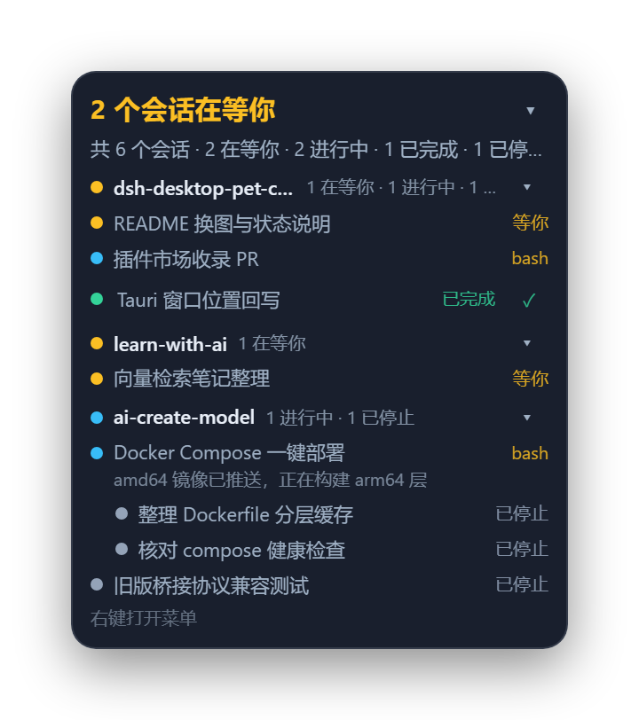
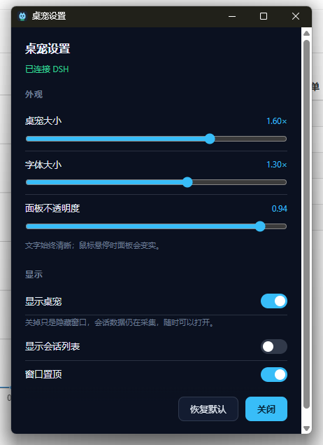

# dsh-desktop-pet-codex

[English](README.md) | [中文](README.zh.md) | 日本語 | [繁體中文](README.zh-tw.md) | [Deutsch](README.de.md)

DeepSeek Harness 用のデスクトップペットです。常に最前面に表示され、気にかけている会話が今どうしているかを
示す roster パネルを添えます。ひとつの契約の下にある二つの半分——Harness を読む DSH ホスト側プラグインと、
それを描く Tauri ウィンドウ——でできています。

<table align="center">
  <tr>
    <td align="center"></td>
    <td align="center"></td>
    <td align="center"></td>
    <td align="center"></td>
    <td align="center"></td>
    <td align="center"></td>
    <td align="center"></td>
  </tr>
  <tr>
    <td align="center"><sub>待機</sub></td>
    <td align="center"><sub>作業中</sub></td>
    <td align="center"><sub>待ち</sub></td>
    <td align="center"><sub>完了</sub></td>
    <td align="center"><sub>手を振る</sub></td>
    <td align="center"><sub>ハート</sub></td>
    <td align="center"><sub>うたた寝</sub></td>
  </tr>
</table>

七つのアニメーションがあります。ペットが切り替える四つのループ状態と、一度だけ再生する三つの短い
リアクションです。以下で roster パネルとあわせて説明します。

## キャラクターの状態

ペットの顔はひとつなので、roster はひとつの気分に畳まれます。注意が活動に勝り、活動が結果に勝ちます。
待っている会話は作業中の会話より優先され、作業中は完了より優先され、`stopped` は専用の顔を持たず静かな
ポーズを借ります。誰も待っていないときは、ペットは最も緊急な会話の結果をまといます。そのため完了した
ターンは、何か別のことが起きるまで画面に残ります。

| 状態 | アニメーション | 表示される条件 |
|---|---|---|
| **待機**<br> | 両手を重ねて立つ。呼吸し、不揃いなリズムでまばたきし、重心を移す | 報告することがない——roster が空、または最も緊急な会話が停止した |
| **作業中**<br> | 横を向いて走り、腕と脚を回す | 監視している会話が作業中。サブエージェントの作業は親の作業中として現れる |
| **待ち**<br> | 人を呼び止めるように片手を上げ、そのまま止めてから下ろす | 監視している会話が読み手の対応待ちで止まっている——承認、質問、ブロック中のツール呼び出し |
| **完了**<br> | 両腕を上げて跳ね、着地して落ち着く | 監視している会話がターンを終えた |
| **手を振る**<br> | 片手を上げて二回振る | キャラクターがクリックされた |
| **ハート**<br> | 胸の前で両手を合わせて目を閉じる | ポインタがキャラクターに乗った（6 秒に最大一度） |
| **うたた寝**<br> | 立ったままうとうとする——目を閉じ、頭が下がり——そして我に返る | roster が五分間空のまま。静かな期間ごとに一度 |

最後の三つは一度きりのセグメントです。表示中のシーンの上に再生され、終わるとスプライトを返し、本当の
シーン切り替えだけがそれを途中で打ち切ります。シーンのテーブルは `pet-app/src/pet-frames.ts` にあり、上の
七つのファイル名はコード名——`idle`、`run`、`wait`、`happy`、`wave`、`heart`、`doze`——です。

`docs/states/` の GIF は、ウィンドウが再生するのと同じフレームテーブルから
`node tools/gen-readme-gifs.mjs` で描画しています。美術素材を二重にコミットすることはありません。

## セッションリスト

roster ウィンドウは、ペットが見張っているものを並べる場所です。DSH が知っている全セッションではなく、
読み手が追っている会話だけを、Workspace ごとにまとめてキャラクターの上に表示します。

<p align="center"></p>

<p align="center"><sub>サンプルデータ：三つの Workspace、読み手を待つ二つの会話、インデントされた二つのサブエージェント行。</sub></p>

**ヘッダー行が数えるのは、読み手を必要としているもの。** 監視している会話が一つでも待っていれば、
待ちの色で `2 个会话在等你` と表示します。そうでなければ結果に分解し、件数のあるフェーズごとに色分けした
セグメントを並べます——`1 完成 · 2 进行 · 1 停止`——roster が空なら `全部空闲` です。その下の行は合計です：
`共 6 个会话 · 2 在等你 · 2 进行中 · 1 已完成 · 1 已停止 · 2 个子代理`。サブエージェントがいる場合だけ
サブエージェント数を添えます。

**グループは Workspace です。** それぞれ Workspace 名、グループ内の件数、そしてその中の最も緊急な
稼働中フェーズに合わせて色づけしたドット（稼働中がなければ灰色）を持ちます。グループの見出しをクリックすると
折りたため、折りたたみ状態は設定ではなくこのウィンドウが覚えます。

**一行が一つの会話です。** 名前は会話のタイトルで、なければディレクトリ、それもなければ短い id に
なります。隣には、実行中は最後に呼ばれたツール（`bash`）、待機中は `等你`——読み手を必要とする行は、
何を呼んだかではなく何を必要としているかを示します——そして終了後は `已完成` または `已停止` が出ます。
実行中の行は最後の思考を二行目に載せることがあり、結果が残っている行は ✓ を伴い、それを押すとその会話が
ペットから外れます。

**サブエージェントが単独の行になることはありません。** 派遣した親の下にインデントでぶら下がり、
件数にも数えません。子が働いていることは親が働いていることです。

**一行をクリックするとその会話が開きます。** DSH を前面に出せるのはウィンドウプロセスだけであり、
セッションを切り替えられるのはプラグインのブラウザ側だけなので、二つの動作は互いを待ちません。
ウィンドウはまずリクエストを留め置き（`PUT /focus`、`202` で応答）、SSE でリクエストが届いたときに
ページが切り替わります。Windows では DSH ウィンドウも前面に来ます。他のプラットフォームでは DSH を開くだけです。

**リストは畳めても、キャラクターは残ります。** ヘッダーの ▾ はパネルをヘッダー行まで折りたたみ、それを
ウィンドウに覚えます。`showSessionList` を切るとウィンドウごと消え、デスクトップにはキャラクターだけが
残ります。キャラクターかパネルを右クリックすると `设置…` と `隐藏桌宠` が出ます。

**bridge が落ちているとき**は、最後の roster が画面に残り、サブタイトルは空のリストの代わりに
`未连接 DSH`（再接続中は `正在连接 DSH…`）と出ます。キャラクターは消えずに灰色になります。

## アーキテクチャ

```
DSH Host process                              your desktop
┌──────────────────────────────┐              ┌──────────────────────────────┐
│ plugin/  (TypeScript bundle) │  127.0.0.1   │ pet-app/  (Tauri process)    │
│  Harness events → roster fold│ ───────────▶ │  pet window      character   │
│  bridge + per-run token      │  HTTP + SSE  │  roster window   the list    │
│  DSH-page routes             │ ◀─────────── │  settings        appearance  │
└──────────────────────────────┘    :47600    └──────────────────────────────┘
```

ウィンドウが描けるものはすべて純粋な roster の畳み込みから出てきます。副作用を持つ側がそれをループバック bridge に
公開し、ウィンドウはそれを読むただのプロセスです。どちらの半分も単独で再起動できます。

DSH ページが使う四つのルート——`/desktop-pet/focus`、`/desktop-pet/focus/events`、
`/desktop-pet/client-state`、`/desktop-pet/pet`——は bridge ではなく **DSH web server** にあります。
ページはそのオリジンから提供されるので、CORS も二つ目のトークンも要りません。

## インストール

**DSH >= 0.2.0-rc.2** が必要です。公開パッケージとリリースアーカイブのどちらも、Windows（x64）、
macOS（Apple silicon と Intel）、Linux（x64）向けのウィンドウバイナリを同梱しているので、一度
インストールすればどの環境でも動き、ローカルで何もビルドする必要はありません。

### npm からインストール

Web サイドバーで **プラグイン → Add plugin** を開いてパッケージ名を入力するか、プラグインマネージャーに
渡します：

```
plugin_manager  action: install_bundle  target: dsh-desktop-pet-codex
```

バージョンを固定するには `dsh-desktop-pet-codex@0.1.1` と書きます。パッケージにはコンパイル済みの
プラグインと四つのウィンドウバイナリが入っているため、インストール時にスクリプトは走らず、ビルドも
不要で、起動時にダウンロードも行いません。

プラグインがコミュニティカタログに載れば、プラグインマーケットでペットを検索してワンクリックでも
インストールできます。

### リリースアーカイブからインストール

プラグインマネージャーの対象をこのアセット URL にします。バージョンを固定したいときや npm に届かない
ときに使います：

```
plugin_manager  action: install_bundle
                target: https://github.com/Mng12345/dsh-desktop-pet-codex/releases/latest/download/dsh-desktop-pet-codex.tgz
```

この URL は常に最新リリースを指します。タグ名の付いた隣のアセットは同じアーカイブで、バージョン固定用
です。アーカイブにはコンパイル済みプラグイン（`package/lib/`）、ブラウザ側の半分、locale ファイル、
`cordis.patch.yml`、そして `package/bin/<platform>-<arch>/` の下に各プラットフォームのウィンドウ
バイナリが一つずつ入っています。プラグインは動作中のマシンに合うものを起動します。

プラットフォームごとの注意：

- **Windows**：追加の依存はありません。
- **Linux**：実行時に WebKitGTK 4.1 が必要です（Tauri ウィンドウの描画に使います）。Debian 12+、
  Ubuntu 24.04+、Fedora 39+ には同梱されています。古いリリースでは別途インストールしてください。
  なくてもプラグインは読み込まれ、ウィンドウが起動しないだけです。
- **macOS**：バイナリは未署名です。Gatekeeper に拒否された場合は、
  `xattr -dr com.apple.quarantine <dsh-desktop-pet のパス>` で隔離フラグを外してください。
- roster の行をクリックして DSH ウィンドウを前面に出せるのは **Windows のみ**です。他のプラットフォーム
  では DSH を開くだけです。

### ソースから——プラグインを開発する場合

```bash
git clone https://github.com/Mng12345/dsh-desktop-pet-codex
```

`plugin/lib/` はコンパイル済みのままリポジトリに入っているので、クローンしても `npm install` もビルドも不要で
インストールできます。プラグインマネージャーを使ってください。プロファイルの `package.json` や
`cordis.patch.yml` を手で書き換える方法はサポートしていません：

```
plugin_manager  action: install_bundle  target: <絶対パス>/dsh-desktop-pet-codex/plugin
```

> **ソースのチェックアウトにはペットのウィンドウがありません。** 実行ファイルはプラットフォームごとの
> ビルド成果物で、git には入っていません（`plugin/bin/`）。クローンにはプラグインはあっても起動する
> ものがありません。Host 側は状態を集めて bridge を提供し、ウィンドウは現れません。ローカルでビルドする
> （[ビルド](#ビルド) を参照）か、リリースアーカイブからインストールしてください。

## ビルド

ビルドには **Node.js >= 22**（`plugin/package.json` の engines）が必要で、ウィンドウには Rust も必要です。

```bash
# plugin: TypeScript -> plugin/lib
cd plugin && npm ci && npm run build
node scripts/smoke.mjs                  # pure core + bridge, no Harness, no window

# window: frontend -> pet-app/dist, then the executable
cd pet-app && npm ci && npm run build   # build:icon, build:ui, cargo build --release
```

実行ファイルは `pet-app/src-tauri/target/release/` に出力されます（Windows では
`dsh-desktop-pet.exe`、その他では `dsh-desktop-pet`）。プラグインが起動できるよう
`plugin/bin/<platform>-<arch>/`——Windows x64 なら `plugin/bin/win32-x64/`——にコピーするか、
`petExecutable` をそこに向けてください。

ウィンドウのビルドには Rust が必要です。リポジトリルートの `rust-toolchain.toml` が channel と target を
固定しており、rustup は作業ディレクトリから上へたどってそれを見つけるので、ビルドはリポジトリ内で実行する
必要があります。両方の半分に `npm run typecheck` があり、`pet-app` には `npm run verify:frames` も
あり、テーブルが指すすべてのフレームが `dist/` に存在するかを確認します。

`node tools/pack-release.mjs` は両方の半分をビルドし、このプラットフォームの実行ファイルを
`plugin/bin/<platform>-<arch>/` にコピーし、`plugin/` で `npm pack` を実行します。そして
`package/lib/index.js`、`package/client.js`、`package/cordis.patch.yml`、locale ファイル、各
プラットフォーム向けにステージしたバイナリのいずれかが欠けたアーカイブの出力を拒否します。
`--skip-build` は `plugin/bin/` をステージ済みのまま詰め、`--require-all` は四つのターゲットがすべて
揃わない限り拒否し（CI が使うのはこれです）、`--out <dir>` は `.tgz` の出力先を変えます（既定は
`.ref/release`）。また、CI ランナー以外のホームディレクトリ名を含むウィンドウバイナリのパックも拒否
します。Rust はすべての panic 箇所のソースパスを記録するため、ノート PC でビルドしたバイナリはその PC のパスを
含んでおり、公開すればパスも公開されるからです。
`RUSTFLAGS=--remap-path-prefix=<home>=~` を付けてビルドすると消せます。リリースワークフローも同じ
フラグを設定しています。

## 設定

ポート、トークン、ウィンドウを起動するかどうかといった配線設定は、`plugin/cordis.patch.yml` の
プラグイン行 `desktop-pet-codex` にあり、**設定 → プラグイン → このバンドル → その行** から編集できます：

| フィールド | 既定値 | 意味 |
|---|---|---|
| `enabled` | `true` | Host 側を起動するか。 |
| `port` / `portAttempts` | `47600` / `20` | ループバックポートと、使用中の場合に続けて試すポート数。 |
| `requireToken` | `true` | bridge のルートで実行ごとのトークンを要求するか。 |
| `autoLaunch` | `true` | Host と一緒にウィンドウを起動する。落ちたら再起動する。 |
| `petExecutable` | `""` | 明示的なバイナリ。空ならバンドル内の `bin/<platform>-<arch>/` を解決する。 |
| `petArgs` | `[]` | ウィンドウへの追加引数。 |
| `sleepAfterMs` | `300000` | 睡眠ポーズ用に予約。ウィンドウ側は同じ値を定数で持つ。 |
| `resyncMs` | `60000` | roster の再基準化の間隔。`0` で自己回復を無効化。 |

外観の持ち主は設定ウィンドウだけです。ペットを右クリック → **设置**（UI は現在中国語です）：

| フィールド | 既定値 | 範囲 | 意味 |
|---|---|---|---|
| `scale` | `1` | 0.6–2 | キャラクターの大きさ。 |
| `fontScale` | `1` | 0.8–1.6 | roster に対する文字の大きさ——大きくなるのは文字で、ペットではない。 |
| `opacity` | `0.94` | 0.3–1 | パネルの不透明度。文字は不透明のまま。 |
| `visible` | `true` | — | ペットを表示する。保存はされず、起動のたびに再表示される。 |
| `showSessionList` | `true` | — | roster ウィンドウ自体が存在するか。 |
| `alwaysOnTop` | `true` | — | これらのウィンドウが他のウィンドウの上に浮かぶか。 |



外観の書き込みは即時で、**クランプ後の値**を返します（確認応答ではありません）。パネルには常に実際に
効いた結果が表示されます。配線設定を変えると行が再適用され、bridge が短時間再起動します。

状態は `~/.dsh/desktop-pet-codex/`（または `$DSH_HOME/desktop-pet-codex/`）にあります：`endpoint.json`、
`watch.json`、`settings.json`、`pending.json`。bridge は `127.0.0.1` にのみバインドし、`GET /health`
以外は実行ごとのトークン（`x-pet-token`、ストリームでは `?token=`）が必要です。

## 設計メモ

**roster は自分で選ぶ集合であり、DSH が知っている全セッションではありません。** 空の集合はその時点で
`running` のものから**シード**されます。会話はターンを開始したとき（`turn/start`）に**入り**、復帰した
ものも含みます。結果が出たあとに確認済みの訪問があるか、✓ で外すか、アーカイブしたときにだけ**出て**
いきます。期限はありません。実行中と待機中の会話は追跡され続けます。

**サブエージェントは決して入りません。** サブエージェントは選ぶものではなく派遣されるもので、見張って
いる会話として扱うとツリーも子行で埋まってしまいます。サブエージェントは見張っている親の子として
描かれ、`origin === 'subagent'` で判定します——血縁だけでは足りません。DSH はサイドスレッドや
プレースホルダーも子として持つからです。

**グループは Workspace で、パスで照合します。** DSH と同じく `session.cwd === workspace.path` です。
Workspace の `sessionIds` は並び順の記録であり、ディレクトリ内の全セッションを列挙しているわけでは
ないので、それで照合すると一つのプロジェクトが同じ名前の複数グループに割れます。どの Workspace も
主張しないセッションは、ディレクトリ全体のパスでグループ化します。

**bridge はトークン付きのループバックで、オリジン固定ではありません。** ペイロードには作業ディレクトリの
パスが含まれるので、境界はバインド先とトークンです。`Access-Control-Allow-Origin: *` を返すのは、ウィンドウが
`http://tauri.localhost` から提供され、オリジンが何も守らないからです。

**行のクリックは順序のない二つの半分です。** DSH を前面に出せるのはウィンドウプロセスだけであり、
セッションを切り替えられるのはプラグインのブラウザ側だけなので、`PUT /focus` はリクエストを留め置き
`202` を返します——受け付けたが、完了していません。このメールボックスは SSE で配信され、ポーリングはしません。
隠れた Chromium レンダラーはタイマーを強く間引くからです。しかもペットのクリックは DSH が隠れている
ときに起きます。

**フェーズに catch-all はありません。** `waiting`（承認、質問、ブロック中のツール呼び出し）、
`running`（作業中の子を含む）、`completed`（理由が `completed` の `turn/end`）、残りは `stopped`。
`idle` はありません。結果のあるセッションは休んでいないので、アイドル状態はグループに属します。

## ディレクトリ構成

```
plugin/
  package.json          dsh バンドル、エクスポート、schemastery の peer
  cordis.patch.yml      プラグイン行、配線の可変項目はすべてここ
  src/core/             純粋：型、デコーダー、roster の畳み込み、設定、wire エンコード
  src/host/             副作用あり：設定、イベントアダプター、bridge、focus ルート、永続化
  client.js             ブラウザ側の半分
  scripts/smoke.mjs     Harness なしで純核心と bridge を動かす
pet-app/
  src/                  各ウィンドウの配線、スナップショットモデル、SSE クライアント、アニメーションテーブル
  public/               pet.html、roster.html、settings.html、style.css、frames/
  src-tauri/src/lib.rs  ウィンドウ機構：透明、常に最前面、クリック透過、二窓の幾何
tools/                  pack-release.mjs がビルドとパック。gen-pet-frames.mjs がポーズフレームを描き、
                        gen-readme-gifs.mjs がそれを docs/states/ に再生する
docs/                   状態 GIF、roster のサンプル、設定ウィンドウのスクリーンショット
```

## GIF ツール

画面録画を GIF にしたい、または大きすぎる GIF を小さくしたいときは、同じ作者のオンライン GIF サイト
GIF Master の [Video to GIF](https://gif-master.com/ja/tools/video-to-gif?utm_source=github) と
[GIF Compressor](https://gif-master.com/ja/tools/gif-compressor?utm_source=github) が使えます。

## ライセンス

MIT——[LICENSE](LICENSE) を参照してください。Copyright (c) 2026 ming。

`pet-app/public/frames/` 以下のポーズフレームと `pet-app/public/pet.png` は著作権者のオリジナル
アートで、同じライセンスが適用されます。
