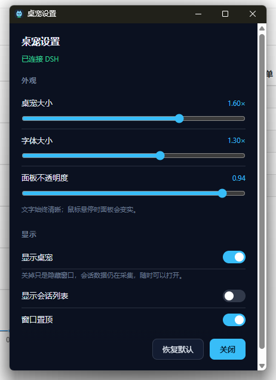

# dsh-desktop-pet-codex

[中文文档](README.zh.md)

A desktop pet for DeepSeek Harness: a small always-on-top character plus a roster panel that shows
what the conversations you care about are doing. It is two halves under one contract — a DSH Host
plugin that reads the Harness, and a Tauri window that draws it.




## Architecture

```
DSH Host process                              your desktop
┌──────────────────────────────┐              ┌──────────────────────────────┐
│ plugin/  (TypeScript bundle) │  127.0.0.1   │ pet-app/  (Tauri process)    │
│  Harness events → roster fold│ ───────────▶ │  pet window      character   │
│  bridge + per-run token      │  HTTP + SSE  │  roster window   the list    │
│  DSH-page routes             │ ◀─────────── │  settings        appearance  │
└──────────────────────────────┘    :47600    └──────────────────────────────┘
```

Everything the window can draw comes out of a pure roster fold; the effectful edge publishes it on a
loopback bridge, and the window is an ordinary process that reads it. Either half restarts alone.

The four routes the DSH page uses — `/desktop-pet/focus`, `/desktop-pet/focus/events`,
`/desktop-pet/client-state`, `/desktop-pet/pet` — are on the **DSH web server**, not the bridge: the
page is served from that origin, so there is no CORS and no second token.

## Install

Requires **DSH >= 0.2.0-rc.2**. The release archive carries a window binary for Windows (x64), macOS
(Apple silicon and Intel) and Linux (x64), so one download installs the whole plugin on any of them and
nothing is built locally.

### Install the release archive

Point the plugin manager at this asset URL:

```
plugin_manager  action: install_bundle
                target: https://github.com/Mng12345/dsh-desktop-pet-codex/releases/latest/download/dsh-desktop-pet-codex.tgz
```

That URL always resolves to the newest release; the asset named after a tag beside it is the same
archive, for pinning one. The archive holds the compiled plugin (`package/lib/`), the browser half, the
locale files, `cordis.patch.yml`, and one window binary per platform under
`package/bin/<platform>-<arch>/` — the plugin starts the one that matches the machine it runs on.

Platform notes:

- **Windows** needs nothing extra.
- **Linux** needs WebKitGTK 4.1 at runtime, which is what a Tauri window draws with: Debian 12+,
  Ubuntu 24.04+ and Fedora 39+ ship it, older releases need it installed separately. Without it the
  plugin still loads and the window simply never starts.
- **macOS** ships an unsigned binary. If Gatekeeper refuses it, clear the quarantine flag with
  `xattr -dr com.apple.quarantine <path to dsh-desktop-pet>`.
- Clicking a roster row raises the DSH window **only on Windows**; elsewhere it opens DSH instead.

### From source — for working on the plugin

```bash
git clone https://github.com/Mng12345/dsh-desktop-pet-codex
```

`plugin/lib/` ships compiled in the repository, so a clone is installable with no `npm install` and no
build. Use the plugin manager; hand-editing the profile's `package.json` or `cordis.patch.yml` is not
supported:

```
plugin_manager  action: install_bundle  target: <abs path>/dsh-desktop-pet-codex/plugin
```

> **A source checkout has no pet window.** The executable is a per-platform build product and is not in
> git (`plugin/bin/`), so a clone has the plugin but nothing to launch: the Host half collects
> state and serves the bridge, and no window appears. Build one locally (see [Build](#build)) or install
> the release archive instead.

## Build

Building needs **Node.js >= 22** (`plugin/package.json` engines) and, for the window, Rust.

```bash
# plugin: TypeScript -> plugin/lib
cd plugin && npm ci && npm run build
node scripts/smoke.mjs                  # pure core + bridge, no Harness, no window

# window: frontend -> pet-app/dist, then the executable
cd pet-app && npm ci && npm run build   # build:icon, build:ui, cargo build --release
```

The executable lands in `pet-app/src-tauri/target/release/` (`dsh-desktop-pet.exe` on Windows,
`dsh-desktop-pet` elsewhere); copy it into `plugin/bin/<platform>-<arch>/` — `plugin/bin/win32-x64/` on a
Windows x64 machine — so the plugin starts it, or point `petExecutable` at it.

The window build needs Rust: `rust-toolchain.toml` pins the channel and target at the repository root,
and rustup finds it by walking up from the working directory, so the build must run inside the repo.
`npm run typecheck` exists in both halves; `npm run verify:frames` in `pet-app` checks that every frame
the tables name is present in `dist/`.

`node tools/pack-release.mjs` builds both halves, copies this platform's executable into
`plugin/bin/<platform>-<arch>/`, runs `npm pack` in `plugin/`, and refuses to emit an archive lacking
`package/lib/index.js`, `package/client.js`, `package/cordis.patch.yml`, the locale files or the binaries
staged for each platform. `--skip-build` packs `plugin/bin/` exactly as staged, `--require-all` refuses
unless all four targets are present (this is what CI uses), and `--out <dir>` moves the `.tgz` (default
`.ref/release`). It also refuses to pack a window binary that names a home directory other than the CI
runner's: Rust records the source path of every panic site, so a binary built on a laptop carries that
laptop's path, and publishing it would publish the path too. Build with
`RUSTFLAGS=--remap-path-prefix=<home>=~` to remove it; the release workflow sets the same flag.

## Configuration

Plumbing — ports, tokens, whether the window is launched — is the plugin row `desktop-pet-codex` in
`plugin/cordis.patch.yml`, editable from **Settings → Plugins → this bundle → the row**:

| Field | Default | Meaning |
|---|---|---|
| `enabled` | `true` | Run the Host half at all. |
| `port` / `portAttempts` | `47600` / `20` | Loopback port, and how many consecutive ports to try when it is taken. |
| `requireToken` | `true` | Require the per-run token on bridge routes. |
| `autoLaunch` | `true` | Start the window with the Host; restart it if it dies. |
| `petExecutable` | `""` | Explicit binary; empty resolves `bin/<platform>-<arch>/` inside the bundle. |
| `petArgs` | `[]` | Extra arguments for the window. |
| `sleepAfterMs` | `300000` | Reserved for the sleeping pose; the window holds the same value as a constant. |
| `resyncMs` | `60000` | Roster re-baseline interval; `0` disables healing. |

Appearance has one owner, the settings window — right-click the pet → **设置** (the UI is Chinese):

| Field | Default | Range | Meaning |
|---|---|---|---|
| `scale` | `1` | 0.6–2 | Size of the character. |
| `fontScale` | `1` | 0.8–1.6 | Text size relative to the roster — grow the text, not the pet. |
| `opacity` | `0.94` | 0.3–1 | Panel translucency; the text stays opaque. |
| `visible` | `true` | — | Show the pet. Not persisted: every start shows the pair again. |
| `showSessionList` | `true` | — | Whether the roster window exists at all. |
| `alwaysOnTop` | `true` | — | Whether the pair floats above other windows. |

Appearance writes are live and answer with the **clamped** value, not an acknowledgement, so the panel
always shows what took effect; a plumbing change re-applies the row and briefly restarts the bridge.

State lives in `~/.dsh/desktop-pet-codex/` (or `$DSH_HOME/desktop-pet-codex/`): `endpoint.json`,
`watch.json`, `settings.json`, `pending.json`. The bridge binds `127.0.0.1` only, and everything but
`GET /health` needs the per-run token (`x-pet-token`, or `?token=` on the stream).

## Design notes

**The roster is a set you curate, not every session DSH knows.** An empty set is **seeded** from
whatever is `running` at that moment; a conversation **enters** when it starts a turn (`turn/start`),
a resumed one included; it **leaves** only after a confirmed visit once it has a result, a ✓ dismissal,
or archiving. No expiry: running and waiting conversations stay tracked.

**A subagent never joins.** Nobody chooses a subagent, it is dispatched, and treating one as watched
would also bury the tree in child rows. Subagents are drawn as children of a watched parent, keyed on
`origin === 'subagent'` — not lineage alone, since DSH also parents side threads and placeholders.

**Groups are Workspaces, matched by path**, exactly as DSH does it: `session.cwd === workspace.path`.
A Workspace's `sessionIds` is an ordering account that does not list every session in the directory,
so matching on it splits one project into identically-named groups; a session no Workspace claims
groups by its whole directory path.

**The bridge is loopback with a token, not origin-locked.** The payload names your working
directories, so the bind and the token are the boundary; `Access-Control-Allow-Origin: *` answers
because the window is served from `http://tauri.localhost` and the origin protects nothing.

**A click on a row is two unsequenced halves.** Only the window process can raise DSH, and only the
plugin's browser half can switch sessions, so `PUT /focus` parks the request and answers `202` —
accepted, not done. That mailbox is pushed over SSE, not polled, because a hidden Chromium renderer
throttles timers hard and a click on the pet happens when DSH is hidden.

**Phases have no catch-all.** `waiting` (approval, question, blocking tool call), `running` (a working
child included), `completed` (`turn/end` with reason `completed`), `stopped` for the rest. No `idle`:
a session with a result is not resting, so idleness belongs to the group.

## Layout

```
plugin/
  package.json          the dsh bundle, exports, and the schemastery peer
  cordis.patch.yml      the row, with every plumbing tunable
  src/core/             pure: types, decoders, the roster fold, settings, wire encoding
  src/host/             effectful: config, event adapters, bridge, focus routes, persistence
  client.js             the browser half
  scripts/smoke.mjs     exercises the pure core and the bridge with no Harness present
pet-app/
  src/                  the windows' wiring, snapshot model, SSE client, animation tables
  public/               pet.html, roster.html, settings.html, style.css, frames/
  src-tauri/src/lib.rs  window mechanics: transparent, always-on-top, click-through, geometry
tools/                  pack-release.mjs builds and packs; gen-pet-frames.mjs regenerates the frames
docs/                   the two screenshots above
```

## License

MIT — see [LICENSE](LICENSE). Copyright (c) 2026 ming.

The pose frames under `pet-app/public/frames/` and `pet-app/public/pet.png` are original artwork by
the copyright holder, under the same licence.
