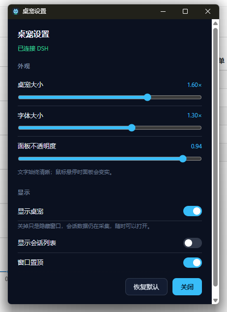

# dsh-desktop-pet-codex

[English](README.md)

给 DeepSeek Harness 用的桌面宠物：一个常驻置顶的小角色，加一块只显示你在意的会话在做什么的状态面板。
项目分两半，共用一层约定——读取 Harness 的 DSH 宿主插件，和负责把状态画出来的 Tauri 窗口。




## 架构

```
DSH 宿主进程                                  你的桌面
┌──────────────────────────────┐              ┌──────────────────────────────┐
│ plugin/  （TypeScript 包）   │  127.0.0.1   │ pet-app/ （Tauri 进程）      │
│  Harness 事件 → roster 折叠  │ ───────────▶ │  pet 窗口        角色        │
│  回环 bridge + 单次运行令牌  │  HTTP + SSE  │  roster 窗口     会话列表    │
│  DSH 页面路由                │ ◀─────────── │  settings        外观设置    │
└──────────────────────────────┘    :47600    └──────────────────────────────┘
```

窗口能画出来的一切都来自一次纯函数式的 roster 折叠；带副作用的那一端把它发布到回环 bridge 上，
窗口只是一个读取该 bridge 的普通桌面进程。两半各自可以单独重启。

DSH 页面自己用的四条路由——`/desktop-pet/focus`、`/desktop-pet/focus/events`、
`/desktop-pet/client-state`、`/desktop-pet/pet`——注册在 **DSH 的 web server** 上而不是 bridge 上：
页面就是从这个源提供的，因此既没有跨域问题，也不需要再传一份令牌。

## 安装

需要 **DSH >= 0.2.0-rc.2**。发布压缩包里带着三平台的窗口二进制——Windows（x64）、macOS（Apple 芯片
和 Intel）、Linux（x64）——所以同一次下载在任何一台上都能装全，本地不构建任何东西。

### 安装发布包（正式安装方式）

把插件管理器的目标指向这个资源直链：

```
plugin_manager  action: install_bundle
                target: https://github.com/Mng12345/dsh-desktop-pet-codex/releases/latest/download/dsh-desktop-pet-codex.tgz
```

这条链接永远指向最新版本；旁边那个带 tag 的同名资源是同一个压缩包，供要固定版本的人使用。包里有编译好的
插件（`package/lib/`）、浏览器端那一半、locale 文件、`cordis.patch.yml`，以及放在
`package/bin/<平台>-<架构>/` 下的各平台窗口二进制——插件启动时会挑与当前机器匹配的那一个。

平台注意事项：

- **Windows**：不需要额外依赖。
- **Linux**：运行时要 WebKitGTK 4.1（Tauri 窗口就是用它渲染的）。Debian 12+、Ubuntu 24.04+、
  Fedora 39+ 自带；更老的发行版要自己装。缺了它插件照常加载，只是窗口不会起来。
- **macOS**：二进制未签名。如果被 Gatekeeper 拦下，清掉隔离标记即可：
  `xattr -dr com.apple.quarantine <dsh-desktop-pet 的路径>`。
- 点名字册里的会话行，只有 **Windows** 上能把 DSH 窗口提到最前；其他平台只是打开 DSH。

### 从源码安装（改插件用的开发路径）

```bash
git clone https://github.com/Mng12345/dsh-desktop-pet-codex
```

编译产物 `plugin/lib/` 随仓库提供，所以克隆下来不用 `npm install`、也不用构建就能装。请用插件管理器安装，
手改 profile 里的 `package.json` 或 `cordis.patch.yml` 都不被支持：

```
plugin_manager  action: install_bundle  target: <本机绝对路径>/dsh-desktop-pet-codex/plugin
```

> **源码检出里没有桌宠窗口。** 窗口可执行文件是按平台生成的构建产物，不入库（`plugin/bin/`）。
> 克隆下来的只有插件本体：宿主这一半照常采集状态、照常提供 bridge，但不会有窗口弹出来。本地自己构建一个
> （见 [构建](#构建)），或者改用发布包安装。

## 构建

构建需要 **Node.js >= 22**（见 `plugin/package.json` 的 engines），构建窗口另需 Rust。

```bash
# 插件：TypeScript -> plugin/lib
cd plugin && npm ci && npm run build
node scripts/smoke.mjs                  # 纯核心 + bridge，不需要 Harness，也不需要窗口

# 窗口：先出前端 pet-app/dist，再出可执行文件
cd pet-app && npm ci && npm run build   # build:icon、build:ui，然后 cargo build --release
```

可执行文件输出在 `pet-app/src-tauri/target/release/`（Windows 上是 `dsh-desktop-pet.exe`，其他平台是
`dsh-desktop-pet`）。把它复制到 `plugin/bin/<平台>-<架构>/`——Windows x64 上就是
`plugin/bin/win32-x64/`——插件就会自动拉起它；开发时也可以直接把 `petExecutable` 指向它。

构建窗口需要 Rust：仓库根目录的 `rust-toolchain.toml` 固定了 channel 和 target，rustup 会从工作目录
向上找到它，所以构建必须在仓库内部的工作目录里跑。两半都有 `npm run typecheck`；`pet-app` 里还有
`npm run verify:frames`，用来检查动画表里点到的每一帧是否都在 `dist/` 中。

`node tools/pack-release.mjs` 会构建两半、把本平台的可执行文件复制进 `plugin/bin/<平台>-<架构>/`、
在 `plugin/` 里跑 `npm pack`，然后检查压缩包是否真的含有 `package/lib/index.js`、`package/client.js`、
`package/cordis.patch.yml`、locale 目录，以及各平台已暂存的二进制——缺任何一项都直接报错而不是发布。
`--skip-build` 表示原样打包 `plugin/bin/` 里已暂存的内容，`--require-all` 表示四个目标缺一不可（CI 用的
就是这个模式），`--out <dir>` 指定 `.tgz` 落点（默认 `.ref/release`）。
它还会拒绝打包"写入了非 CI 账号家目录"的窗口二进制：Rust 会把每个 panic 位置对应的源码路径写进二进制，
在笔记本上编出来的 exe 因此带着这台机器的家目录，发布出去等于把路径一起公开。构建时用
`RUSTFLAGS=--remap-path-prefix=<家目录>=~` 把它洗掉即可，发布流程设的是同一个参数。

## 配置

端口、令牌、是否随宿主拉起窗口这类管线配置，属于 `plugin/cordis.patch.yml` 里的插件行
`desktop-pet-codex`，也可以在 **设置 → 插件 → 本包 → 该行** 里改：

| 字段 | 默认值 | 含义 |
|---|---|---|
| `enabled` | `true` | 是否启动宿主这一半。 |
| `port` / `portAttempts` | `47600` / `20` | 回环端口，以及端口被占用时依次往后尝试多少个。 |
| `requireToken` | `true` | bridge 路由是否要求单次运行令牌。 |
| `autoLaunch` | `true` | 是否随宿主拉起窗口；窗口意外退出后会再次拉起。 |
| `petExecutable` | `""` | 指定二进制；留空则解析包内的 `bin/<平台>-<架构>/`。 |
| `petArgs` | `[]` | 追加给窗口的额外参数。 |
| `sleepAfterMs` | `300000` | 预留给睡眠姿态；窗口里目前以常量持有同一个值。 |
| `resyncMs` | `60000` | roster 重新对齐的间隔；`0` 表示关闭自愈。 |

外观只有一个归属：设置窗口（右键桌宠 → **设置**，界面目前是中文）：

| 字段 | 默认值 | 范围 | 含义 |
|---|---|---|---|
| `scale` | `1` | 0.6–2 | 角色大小。 |
| `fontScale` | `1` | 0.8–1.6 | 相对 roster 的字号——放大的只有字，不是人。 |
| `opacity` | `0.94` | 0.3–1 | 面板透明度；文字保持不透明。 |
| `visible` | `true` | — | 是否显示桌宠。不落盘：每次启动都会重新显示这一对窗口。 |
| `showSessionList` | `true` | — | 会话列表窗口是否存在。 |
| `alwaysOnTop` | `true` | — | 这一对窗口是否悬浮在其他窗口之上。 |

外观写入是实时的，并且返回的是**被钳制后的值**而不是一句“收到”，所以面板显示的永远是真正生效的结果；
改动管线配置则会重新应用插件行，bridge 会短暂重启一次。

运行状态存放在 `~/.dsh/desktop-pet-codex/`（或 `$DSH_HOME/desktop-pet-codex/`）：`endpoint.json`、
`watch.json`、`settings.json`、`pending.json`。bridge 只绑定 `127.0.0.1`，除 `GET /health` 之外的
请求都要带单次运行令牌（`x-pet-token`，事件流可用 `?token=`）。

## 设计说明

**roster 是一份你圈定的集合，不是 DSH 知道的所有会话。** 空集合会从当时 `running` 的会话**播种**，
避免第一次打开是一片空白；会话开始一轮（`turn/start`）时**进入**，从空闲中恢复的也算；只有在已有结果
之后被确认访问、点 ✓ 移除、或归档，才会**离开**。刻意没有过期机制：运行中和等待中的会话会一直跟踪。

**子代理永远不会进入。** 子代理不是人选的，是被派发的，把它当成“你选中的会话”本身就不成立，还会让
树里塞满子行。子代理画在被跟踪父会话下面，判断依据是 `origin === 'subagent'`（DSH 侧边栏也是按它
过滤的），而不只看亲缘关系——DSH 也会把侧线程、重复占位符挂成子级。

**分组用的是 Workspace，按路径匹配**，和 DSH 自己的判定一致：`session.cwd === workspace.path`。
Workspace 上的 `sessionIds` 看着等价其实不等价，那份字段只记录排序，并不包含目录下的全部会话，按它
匹配会把一个项目拆成几个同名分组。没有 Workspace 认领的会话退回按目录分组，键是整条路径。

**bridge 是回环加令牌，而不是锁定来源。** 它承载的数据里含你的工作目录，所以边界是绑定地址和令牌；
响应带 `Access-Control-Allow-Origin: *`，是因为窗口从 `http://tauri.localhost` 加载，来源本来就不承担
防护作用。

**点一行是两个互不等待的动作。** 把 DSH 提到前台只有窗口进程做得到，切换会话只有插件的浏览器端做得到，
所以 `PUT /focus` 只是把请求挂进信箱并回 `202`——已接受，未完成。信箱走 SSE 推送而不是轮询：
隐藏窗口里的 Chromium 会把定时器节流得很厉害，而点桌宠恰恰发生在 DSH 隐藏的时候。

**会话阶段没有兜底分支。** `waiting`（审批、待回答的问题、阻塞中的工具调用）、`running`（含正在干活的
子会话）、`completed`（`turn/end` 且原因为 `completed`），其余一律 `stopped`。没有 `idle`：有结果的会话
不算闲着，空闲属于分组。

## 目录结构

```
plugin/
  package.json          dsh 包声明、导出、以及 schemastery 的 peer 依赖
  cordis.patch.yml      插件行，所有管线可调项都在这里
  src/core/             纯函数：类型、解码器、roster 折叠、设置、报文编码
  src/host/             有副作用：配置、事件适配、bridge、focus 路由、持久化
  client.js             浏览器端那一半
  scripts/smoke.mjs     不需要 Harness 就能跑纯核心和 bridge
pet-app/
  src/                  各窗口接线、快照模型、SSE 客户端、动画表
  public/               pet.html、roster.html、settings.html、style.css、frames/
  src-tauri/src/lib.rs  窗口机制：透明、置顶、点击穿透、两窗几何关系
tools/                  pack-release.mjs 负责构建与打包；gen-pet-frames.mjs 重新生成姿态帧
docs/                  上面那两张截图
```

## 许可

MIT，见 [LICENSE](LICENSE)。Copyright (c) 2026 ming。

`pet-app/public/frames/` 下的姿态帧和 `pet-app/public/pet.png` 是版权持有者的原创美术，适用同一许可。
