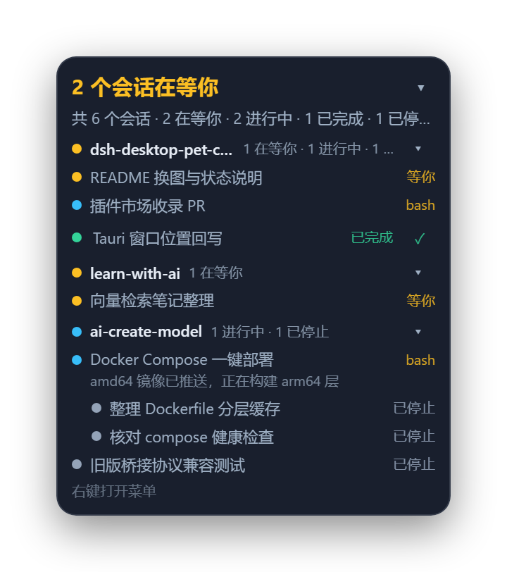
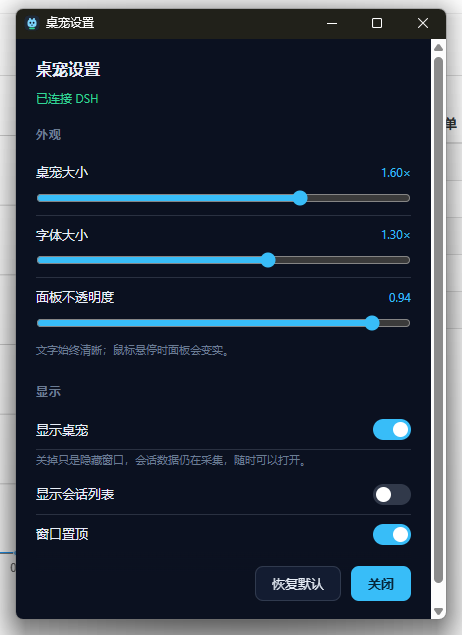

# dsh-desktop-pet-codex

<!-- Generated from ../README.de.md by tools/sync-plugin-readmes.mjs; do not edit. -->

[English](README.md) | [中文](README.zh.md) | [日本語](README.ja.md) | [繁體中文](README.zh-tw.md) | Deutsch

Ein Desktop-Pet für DeepSeek Harness: eine kleine, immer im Vordergrund stehende Figur und ein Roster-Panel, das zeigt, was die Unterhaltungen machen, die Ihnen wichtig sind. Es besteht aus zwei Hälften
unter einem Vertrag – einem DSH-Host-Plugin, das Harness liest, und einem Tauri-Fenster, das es zeichnet.

      

*Ruhe · Arbeit · Warten · Fertig · Winken · Herz · Nickerchen*

Sieben Animationen: vier Schleifenzustände, zwischen denen das Pet wechselt, und drei kurze Reaktionen,
die einmal ablaufen. Unten werden sie zusammen mit dem Roster-Panel beschrieben.

## Charakterzustände

Ein Pet hat nur ein Gesicht, also faltet sich das Roster zu einer Stimmung zusammen. Aufmerksamkeit
schlägt Aktivität, Aktivität schlägt Nachwirkung: eine wartende Unterhaltung rangiert vor einer
arbeitenden, eine arbeitende vor einer fertigen, und `stopped` hat kein eigenes Gesicht – es leiht sich
die stille Pose. Solange niemand wartet, trägt das Pet das Ergebnis der dringendsten Unterhaltung, sodass
eine beendete Runde auf dem Bildschirm bleibt, bis etwas anderes passiert.

| Status | Animation | Wird angezeigt, wenn |
|---|---|---|
| **Ruhe**<br> | steht mit gefalteten Händen; atmet, blinzelt in unregelmäßigem Takt, verlagert das Gewicht | nichts zu berichten – das Roster ist leer oder seine dringendste Unterhaltung ist gestoppt |
| **Arbeit**<br> | läuft im Profil, Arme und Beine kreisen | eine überwachte Unterhaltung arbeitet; ein arbeitender Subagent erscheint als arbeitender Elternteil |
| **Warten**<br> | hebt eine Hand, als wollte sie jemanden anhalten, hält sie und senkt sie wieder | eine überwachte Unterhaltung wartet auf den Leser – eine Genehmigung, eine Frage, ein blockierender Tool-Aufruf |
| **Fertig**<br> | hüpft mit beiden Armen hoch, landet und kommt zur Ruhe | eine überwachte Unterhaltung hat ihre Runde beendet |
| **Winken**<br> | hebt eine Hand und winkt zweimal | die Figur wird angeklickt |
| **Herz**<br> | legt die Hände vor der Brust zusammen und schließt die Augen | der Zeiger landet auf der Figur, höchstens alle 6 Sekunden |
| **Nickerchen**<br> | döst im Stehen weg – die Augen schließen sich, der Kopf sinkt – und fängt sich wieder | das Roster ist seit fünf Minuten leer; einmal pro ruhiger Phase |

Die letzten drei sind einmalige Segmente: Sie spielen über der jeweils sichtbaren Szene, geben den Sprite
danach zurück, und nur ein echter Szenenwechsel bricht sie ab. Die Szenentabellen liegen in
`pet-app/src/pet-frames.ts`; die sieben Dateien oben sind nach ihren Codenamen benannt – `idle`, `run`,
`wait`, `happy`, `wave`, `heart`, `doze`.

Die GIFs unter `docs/states/` werden aus denselben Frame-Tabellen gerendert, die das Fenster abspielt,
und zwar von `node tools/gen-readme-gifs.mjs` – kein Artwork wird doppelt eingecheckt.

## Sitzungsliste

Das Roster-Fenster ist der Ort, an dem das Pet auflistet, was es beobachtet: die Unterhaltungen, die der
Leser nachverfolgt, nicht jede Sitzung, die DSH kennt – gruppiert nach Workspace und über der Figur
verankert.



*Beispieldaten: drei Workspaces, zwei Unterhaltungen warten auf den Leser und zwei eingerückte Subagent-Zeilen.*

**Die Kopfzeile zählt, was den Leser braucht.** Solange mindestens eine überwachte Unterhaltung wartet,
steht dort `2 个会话在等你` in der Wartefarbe. Sonst zerfällt sie in die Ergebnisse, ein farbiger
Abschnitt pro Phase, die etwas hat – `1 完成 · 2 进行 · 1 停止` – und ein leeres Roster zeigt
`全部空闲`. Die Zeile darunter ist die Summe: `共 6 个会话 · 2 在等你 · 2 进行中 · 1 已完成 ·
1 已停止 · 2 个子代理`, mit der Subagent-Zahl nur, wenn es Subagents gibt.

**Gruppen sind Workspaces**, jede mit Workspace-Namen, eigenen Zählern und einem Punkt, der nach der
dringendsten aktiven Phase darin gefärbt ist (grau, wenn nichts aktiv ist). Ein Klick auf den Gruppentitel
faltet sie, und das Fenster merkt sich die Faltung, nicht die Einstellungen.

**Eine Zeile ist eine Unterhaltung.** Der Name ist der Titel der Unterhaltung, ersatzweise ihr Verzeichnis
und dann eine kurze id. Daneben steht das letzte Tool, solange sie läuft (`bash`), `等你`, solange sie
wartet – eine Zeile, die den Leser braucht, sagt, was sie braucht, nicht, was sie aufgerufen hat – und
`已完成` oder `已停止`, sobald sie sich beruhigt hat. Eine laufende Zeile kann ihren letzten Gedanken in
einer zweiten Zeile tragen, und ein erhaltenes Ergebnis trägt ein ✓, das diese Unterhaltung vom Pet
entfernt.

**Subagents sind nie eigene Zeilen.** Sie hängen eingerückt unter dem Elternteil, der sie entsandt hat,
und zählen nicht mit: ein arbeitendes Kind ist ein arbeitender Elternteil.

**Ein Klick öffnet diese Unterhaltung.** Nur der Fensterprozess kann DSH nach vorn holen, und nur die
Browser-Hälfte des Plugins kann Sitzungen wechseln, also warten die beiden Aktionen nicht aufeinander:
Das Fenster legt die Anfrage ab (`PUT /focus`, beantwortet mit `202`) und die Seite wechselt, wenn die
Anfrage per SSE zugestellt wird. Unter Windows kommt das DSH-Fenster zusätzlich nach vorn; anderswo
wird DSH nur geöffnet.

**Die Liste faltet sich, die Figur bleibt.** Das ▾ in der Kopfzeile faltet das Panel auf seine Kopfzeile
zusammen und merkt sich das im Fenster; `showSessionList` auszuschalten entfernt das Fenster ganz und
lässt nur die Figur auf dem Desktop. Ein Rechtsklick auf die Figur oder das Panel bietet `设置…` und
`隐藏桌宠`.

**Wenn die bridge weg ist**, bleibt das letzte Roster auf dem Bildschirm und der Untertitel sagt
`未连接 DSH` (`正在连接 DSH…` beim erneuten Versuch), statt eine leere Liste zu zeigen; die Figur wird
grau, statt zu verschwinden.

## Architektur

```
DSH Host process                              your desktop
┌──────────────────────────────┐              ┌──────────────────────────────┐
│ plugin/  (TypeScript bundle) │  127.0.0.1   │ pet-app/  (Tauri process)    │
│  Harness events → Roster fold│ ───────────▶ │  pet window      character   │
│  bridge + per-run token      │  HTTP + SSE  │  Roster window   the list    │
│  DSH-page routes             │ ◀─────────── │  settings        appearance  │
└──────────────────────────────┘    :47600    └──────────────────────────────┘
```

Alles, was das Fenster zeichnen kann, stammt aus einer reinen Roster-Faltung; die Seite mit den Effekten
veröffentlicht sie auf einer loopback bridge, und das Fenster ist nur ein gewöhnlicher Prozess, der sie
liest. Beide Hälften lassen sich einzeln neu starten.

Die vier Routen, die die DSH-Seite nutzt – `/desktop-pet/focus`, `/desktop-pet/focus/events`,
`/desktop-pet/client-state`, `/desktop-pet/pet` – liegen auf dem **DSH web server**, nicht auf der
bridge: Die Seite wird von dieser Origin ausgeliefert, also gibt es weder CORS noch ein zweites Token.

## Installation

Erfordert **DSH >= 0.2.0-rc.2**. Das veröffentlichte Paket und das Release-Archiv bringen beide ein
Fenster-Binary für Windows (x64), macOS (Apple Silicon und Intel) und Linux (x64) mit, sodass eine
Installation auf allen dreien funktioniert und lokal nichts gebaut wird.

### Installation aus npm

Fordern Sie das Paket über seinen Namen an – öffnen Sie in der Web-Seitenleiste **Plugins → Add plugin**
und geben Sie ihn ein, oder übergeben Sie ihn dem Plugin-Manager:

```
plugin_manager  action: install_bundle  target: dsh-desktop-pet-codex
```

Eine Version pinnt man mit `dsh-desktop-pet-codex@0.1.2`. Das Paket enthält das kompilierte Plugin und
alle vier Fenster-Binaries, daher führt die Installation keine Install-Skripte aus, braucht keinen
Build-Schritt und lädt beim Start nichts herunter.

Sobald das Plugin im Community-Katalog steht, installiert auch die Suche im Plugin-Markt das Pet mit
einem Klick.

### Installation aus dem Release-Archiv

Richten Sie den Plugin-Manager auf diese Asset-URL – verwenden Sie sie, um eine Version zu pinnen, oder
wenn npm nicht erreichbar ist:

```
plugin_manager  action: install_bundle
                target: https://github.com/Mng12345/dsh-desktop-pet-codex/releases/latest/download/dsh-desktop-pet-codex.tgz
```

Diese URL löst immer auf das neueste Release auf; das Asset mit einem Tag-Namen daneben ist dasselbe
Archiv, zum Pinnen einer Version. Das Archiv enthält das kompilierte Plugin (`package/lib/`), die
Browser-Hälfte, die Locale-Dateien, `cordis.patch.yml` und je ein Fenster-Binary pro Plattform unter
`package/bin/<platform>-<arch>/` – das Plugin startet das, das zur laufenden Maschine passt.

Hinweise zu den Plattformen:

- **Windows**: braucht nichts weiter.
- **Linux**: braucht zur Laufzeit WebKitGTK 4.1 (damit zeichnet ein Tauri-Fenster). Debian 12+,
  Ubuntu 24.04+ und Fedora 39+ bringen es mit, ältere Releases müssen es nachinstallieren. Ohne es lädt
  das Plugin weiter, und das Fenster startet einfach nie.
- **macOS**: liefert ein unsigniertes Binary. Wenn Gatekeeper es ablehnt, entfernen Sie das
  Quarantäne-Flag mit `xattr -dr com.apple.quarantine <Pfad zu dsh-desktop-pet>`.
- Ein Klick auf eine Roster-Zeile holt das DSH-Fenster **nur unter Windows** nach vorn; anderswo wird
  DSH nur geöffnet.

### Aus dem Quellcode – zum Arbeiten am Plugin

```bash
git clone https://github.com/Mng12345/dsh-desktop-pet-codex
```

`plugin/lib/` liegt kompiliert im Repository, also ist ein Klon ohne `npm install` und ohne Build
installierbar. Nutzen Sie den Plugin-Manager; das Bearbeiten der `package.json` oder
`cordis.patch.yml` im Profil von Hand wird nicht unterstützt:

```
plugin_manager  action: install_bundle  target: <absoluter Pfad>/dsh-desktop-pet-codex/plugin
```

> **Ein Quellcode-Checkout hat kein Pet-Fenster.** Das Executable ist ein plattformspezifisches
> Build-Produkt und liegt nicht in git (`plugin/bin/`). Ein Klon hat also das Plugin, aber nichts zum
> Starten: Die Host-Hälfte sammelt Zustand und bedient die bridge, und kein Fenster erscheint. Bauen Sie
> lokal eines (siehe [Build](#build)) oder installieren Sie stattdessen das Release-Archiv.

## Build

Der Build braucht **Node.js >= 22** (`plugin/package.json` engines) und für das Fenster Rust.

```bash
# plugin: TypeScript -> plugin/lib
cd plugin && npm ci && npm run build
node scripts/smoke.mjs                  # pure core + bridge, no Harness, no window

# window: frontend -> pet-app/dist, then the executable
cd pet-app && npm ci && npm run build   # build:icon, build:ui, cargo build --release
```

Das Executable landet in `pet-app/src-tauri/target/release/` (`dsh-desktop-pet.exe` unter Windows, sonst
`dsh-desktop-pet`); kopieren Sie es nach `plugin/bin/<platform>-<arch>/` – auf einer Windows-x64-Maschine
`plugin/bin/win32-x64/` –, damit das Plugin es startet, oder richten Sie `petExecutable` darauf.

Der Fenster-Build braucht Rust: `rust-toolchain.toml` pinnt Channel und Target im Repository-Root, und
rustup findet es, indem es vom Arbeitsverzeichnis nach oben läuft – der Build muss also im Repo laufen.
`npm run typecheck` gibt es in beiden Hälften; `npm run verify:frames` in `pet-app` prüft, dass jeder
Frame, den die Tabellen nennen, in `dist/` vorhanden ist.

`node tools/pack-release.mjs` baut beide Hälften, kopiert das Executable dieser Plattform nach
`plugin/bin/<platform>-<arch>/`, führt `npm pack` in `plugin/` aus und weigert sich, ein Archiv ohne
`package/lib/index.js`, `package/client.js`, `package/cordis.patch.yml`, die Locale-Dateien oder die für
jede Plattform bereitgestellten Binaries auszugeben. `--skip-build` packt `plugin/bin/` genau so, wie es
bereitliegt, `--require-all` bricht ab, sofern nicht alle vier Ziele vorhanden sind (das nutzt die CI),
und `--out <dir>` verschiebt die `.tgz` (Standard: `.ref/release`). Es weigert sich auch, ein
Fenster-Binary zu packen, das auf ein anderes Home-Verzeichnis als das des CI-Runners verweist: Rust zeichnet
den Quellpfad jeder Panic-Stelle auf, ein auf einem Laptop gebautes Binary trägt also den Pfad dieses
Laptops, und es zu veröffentlichen würde den Pfad mitveröffentlichen. Bauen Sie mit
`RUSTFLAGS=--remap-path-prefix=<home>=~`, um ihn zu entfernen; der Release-Workflow setzt dasselbe Flag.

## Konfiguration

Plumbing – Ports, Tokens, ob das Fenster gestartet wird – ist die Plugin-Zeile `desktop-pet-codex` in
`plugin/cordis.patch.yml`, editierbar unter **Einstellungen → Plugins → dieses Bundle → die Zeile**:

| Feld | Standard | Bedeutung |
|---|---|---|
| `enabled` | `true` | Startet die Host-Hälfte überhaupt. |
| `port` / `portAttempts` | `47600` / `20` | Loopback-Port und wie viele aufeinanderfolgende Ports bei Belegung probiert werden. |
| `requireToken` | `true` | Verlangt das Pro-Lauf-Token auf bridge-Routen. |
| `autoLaunch` | `true` | Startet das Fenster mit dem Host; startet es neu, wenn es stirbt. |
| `petExecutable` | `""` | Explizites Binary; leer löst `bin/<platform>-<arch>/` im Bundle auf. |
| `petArgs` | `[]` | Zusätzliche Argumente für das Fenster. |
| `sleepAfterMs` | `300000` | Für die Schlafpose reserviert; das Fenster hält denselben Wert als Konstante. |
| `resyncMs` | `60000` | Intervall für die Neuausrichtung des Roster; `0` deaktiviert die Selbstheilung. |

Das Aussehen hat einen Eigentümer, das Einstellungsfenster – Rechtsklick auf das Pet → **设置**
(die UI ist Chinesisch):

| Feld | Standard | Bereich | Bedeutung |
|---|---|---|---|
| `scale` | `1` | 0.6–2 | Größe der Figur. |
| `fontScale` | `1` | 0.8–1.6 | Textgröße relativ zum Roster – vergrößern Sie den Text, nicht das Pet. |
| `opacity` | `0.94` | 0.3–1 | Deckkraft des Panels; der Text bleibt undurchsichtig. |
| `visible` | `true` | — | Zeigt das Pet. Nicht persistiert: Jeder Start zeigt das Paar wieder. |
| `showSessionList` | `true` | — | Ob es das Roster-Fenster überhaupt gibt. |
| `alwaysOnTop` | `true` | — | Ob das Paar über anderen Fenstern schwebt. |



Schreibvorgänge am Aussehen sind live und antworten mit dem **geklemmten** Wert, nicht mit einer
Bestätigung, sodass das Panel immer zeigt, was tatsächlich wirkt; eine Änderung am Plumbing wendet die
Zeile neu an und startet die bridge kurz neu.

Der Zustand liegt in `~/.dsh/desktop-pet-codex/` (oder `$DSH_HOME/desktop-pet-codex/`): `endpoint.json`,
`watch.json`, `settings.json`, `pending.json`. Die bridge bindet nur `127.0.0.1`, und alles außer
`GET /health` braucht das Pro-Lauf-Token (`x-pet-token` oder `?token=` im Stream).

## Design-Notizen

**Das Roster ist eine Menge, die Sie kuratieren, nicht jede Sitzung, die DSH kennt.** Eine leere Menge
wird mit dem **geseedet**, was in diesem Moment `running` ist; eine Unterhaltung **kommt hinzu**, wenn sie
eine Runde startet (`turn/start`), eine fortgesetzte eingeschlossen; sie **verlässt** die Menge erst nach
einem bestätigten Besuch mit Ergebnis, per ✓-Entfernung oder durch Archivieren. Kein
Ablauf: laufende und wartende Unterhaltungen bleiben verfolgt.

**Ein Subagent kommt nie hinzu.** Niemand wählt einen Subagenten aus, er wird entsandt, und ihn als
überwacht zu behandeln würde den Baum ebenfalls in Kindzeilen auflösen. Subagents werden als Kinder eines
überwachten Elternteils gezeichnet, erkannt an `origin === 'subagent'` – nicht an der Abstammung allein,
denn DSH hängt auch Seitenthreads und Platzhalter als Eltern ein.

**Gruppen sind Workspaces, per Pfad abgeglichen** – genau wie DSH es macht: `session.cwd === workspace.path`. Die `sessionIds` eines Workspace sind nur eine Reihenfolgeangabe, keine Aufzählung aller Sitzungen im
Verzeichnis; ein Abgleich darauf zerlegt ein Projekt daher in gleichnamige Gruppen. Eine Sitzung, die kein
Workspace beansprucht, gruppiert nach ihrem ganzen Verzeichnispfad.

**Die bridge ist Loopback mit Token, nicht origin-gesperrt.** Die Nutzlast nennt Ihre
Arbeitsverzeichnisse, also sind die Bind-Adresse und das Token die Grenze;
`Access-Control-Allow-Origin: *` antwortet, weil das Fenster von `http://tauri.localhost` ausgeliefert
wird und der Origin nichts schützt.

**Ein Klick auf eine Zeile besteht aus zwei ungeordneten Hälften.** Nur der Fensterprozess kann DSH nach vorn
holen, und nur die Browser-Hälfte des Plugins kann Sitzungen wechseln, also legt `PUT /focus` die Anfrage
ab und antwortet `202` – angenommen, nicht erledigt. Dieses Postfach wird per SSE zugestellt, nicht
gepollt, weil ein versteckter Chromium-Renderer Timer stark drosselt und ein Klick auf das Pet passiert,
während DSH versteckt ist.

**Phasen haben kein Catch-all.** `waiting` (Genehmigung, Frage, blockierender Tool-Aufruf), `running`
(ein arbeitendes Kind eingeschlossen), `completed` (`turn/end` mit Grund `completed`), der Rest
`stopped`. Kein `idle`: eine Sitzung mit einem Ergebnis ruht nicht, also gehört Müßiggang zur Gruppe.

## Verzeichnisstruktur

```
plugin/
  package.json          das dsh-Bundle, Exporte und der schemastery-Peer
  cordis.patch.yml      die Zeile, mit jedem Plumbing-Tunable
  src/core/             rein: Typen, Decoder, Roster-Faltung, Einstellungen, Wire-Encoding
  src/host/             seiteneffektbehaftet: Konfiguration, Event-Adapter, bridge, focus-Routen, Persistenz
  client.js             die Browser-Hälfte
  scripts/smoke.mjs     prüft den puren Kern und die bridge ohne Harness
pet-app/
  src/                  die Verdrahtung der Fenster, Snapshot-Modell, SSE-Client, Animationstabellen
  public/               pet.html, roster.html, settings.html, style.css, frames/
  src-tauri/src/lib.rs  Fenstermechanik: transparent, always-on-top, click-through, Geometrie
tools/                  pack-release.mjs baut und packt; gen-pet-frames.mjs zeichnet die Frames;
                        gen-readme-gifs.mjs spielt sie in docs/states/ für dieses README
docs/                   die Status-GIFs, das Roster-Beispiel und der Einstellungs-Screenshot
```

## GIF-Tools

Wenn eine Bildschirmaufnahme zu einem GIF werden soll oder ein vorhandenes GIF zu groß ist: GIF Master,
die Online-GIF-Seite desselben Autors, hat beides – [Video to GIF](https://gif-master.com/de/tools/video-to-gif?utm_source=github)
wandelt Bildschirmaufnahmen in GIFs um, [GIF Compressor](https://gif-master.com/de/tools/gif-compressor?utm_source=github)
verkleinert vorhandene GIFs.

## Lizenz

MIT – siehe [LICENSE](LICENSE). Copyright (c) 2026 ming.

Die Posen-Frames unter `pet-app/public/frames/` und `pet-app/public/pet.png` sind Original-Artwork des
Copyright-Inhabers unter derselben Lizenz.
