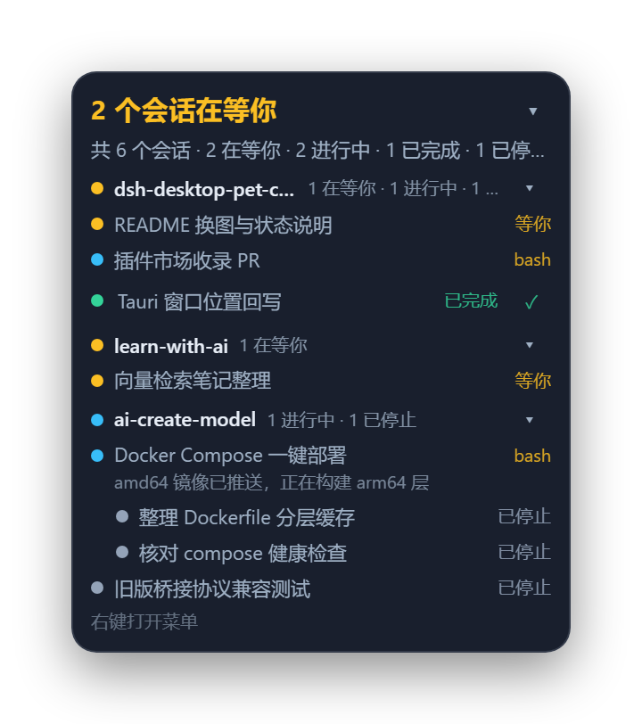
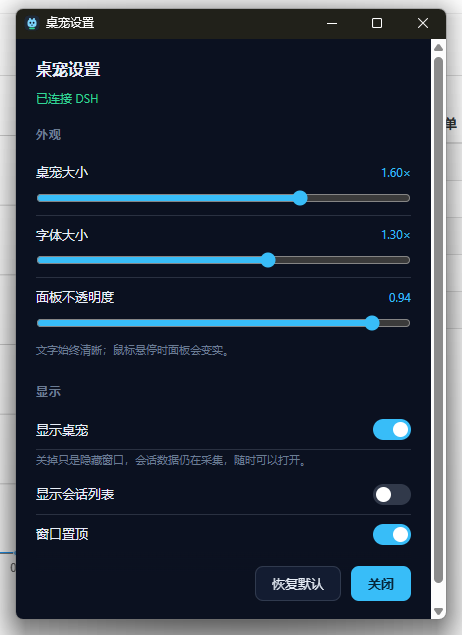

# dsh-desktop-pet-codex

<!-- Generated from ../README.zh-tw.md by tools/sync-plugin-readmes.mjs; do not edit. -->

[English](README.md) | [中文](README.zh.md) | [日本語](README.ja.md) | 繁體中文 | [Deutsch](README.de.md)

給 DeepSeek Harness 用的桌面寵物：一個常駐最上層的小角色，加上一塊只顯示使用者在意的會話在做什麼的
狀態面板。專案分兩半，共用一層約定——讀取 Harness 的 DSH 宿主外掛，以及負責把狀態畫出來的 Tauri 視窗。

      

*待機 · 工作 · 等待 · 完成 · 招手 · 愛心 · 打盹*

七段動畫：四種循環狀態、三種一次性反應；下面兩節講它們和會話清單。

## 角色狀態

角色只有一張臉，所以 roster 得收合成一種情緒：注意力壓過動作，動作壓過結果——等待中的會話排在進行中
的之前，進行中的排在已完成之前；`stopped` 沒有自己的表情，借用安靜的那一套。沒人等待時，角色呈現的是
最緊急那條會話的結果，所以一個完成的回合會一直留在臉上，直到有其他事情發生。

| 狀態 | 動作 | 何時出現 |
|---|---|---|
| **待機**<br> | 雙手交疊站著；呼吸、眨眼（節拍不均）、換重心 | 沒有可回報的事情——roster 為空，或其中最緊急的會話已停止 |
| **工作**<br> | 側身原地跑，手臂和腿循環擺動 | 有被追蹤的會話在忙；子代理在忙時按父會話的「工作」呈現 |
| **等待**<br> | 舉起一隻手，像在招呼人，停住，再放下 | 有被追蹤的會話卡在使用者這裡——核准、待回答的問題、阻塞中的工具呼叫 |
| **完成**<br> | 雙臂舉起跳一下，落地後站定 | 有被追蹤的會話結束了回合 |
| **招手**<br> | 抬起一隻手揮兩下 | 點擊角色 |
| **愛心**<br> | 雙手在胸前合攏，閉上眼 | 游標落到角色身上，最多每 6 秒一次 |
| **打盹**<br> | 站著睡著——閉眼、低頭——然後驚醒 | roster 空了五分鐘；每段安靜期只播一次 |

最後三個是一次性分段：它們在目前場景之上播放，播完把畫面交回場景，只有真正的場景切換才會打斷。場景表
在 `pet-app/src/pet-frames.ts`；上面七個檔名就是程式裡的場景名——`idle`、`run`、`wait`、`happy`、
`wave`、`heart`、`doze`。

`docs/states/` 下的 GIF 由 `node tools/gen-readme-gifs.mjs` 用同一份影格表渲染，美術資源不重複進版控。

## 會話清單

會話清單視窗把桌寵追蹤的會話列出來：只放使用者追蹤的，而不是 DSH 知道的所有工作階段，按 Workspace
分組，掛在角色上方。



*範例資料：三個 Workspace，兩條會話在等使用者，兩列縮排的子代理。*

**標題列統計的是要找使用者的會話。** 只要有一個被追蹤的會話在等，這一列就用等待色寫
`2 个会话在等你`；否則拆成結果，每個有數的階段各一段、各帶自己的顏色——`1 完成 · 2 进行 · 1 停止`——
空 roster 則顯示 `全部空闲`。下面一列是總數：`共 6 个会话 · 2 在等你 · 2 进行中 · 1 已完成 · 1 已停止 ·
2 个子代理`，只有存在子代理時才帶子代理數。

**分組就是 Workspace**，群組標頭是 Workspace 名稱、本組計數，以及一個按組內最緊急進行中階段上色的小
圓點（沒有進行中階段時是灰色）。點群組標頭可以收合這一組，收合狀態記在視窗自己這裡，不進設定。

**一列是一條會話。** 名稱是會話標題，沒有就退到目錄，再沒有就用短 id。旁邊：執行時顯示最近呼叫的
工具名稱（`bash`），等待時固定寫 `等你`——要找使用者的列說的是「需要什麼」，而不是「呼叫了什麼」；
結束之後寫 `已完成` 或 `已停止`。執行中的列可以在第二列帶上最近的想法；已有結果的列帶一個 ✓，點它把
這條會話從桌寵上移除。

**子代理永遠不會單獨成列。** 它們縮排掛在派發它的父會話下面，也不計入統計：子代理在忙就是父會話在忙。

**點一列會開啟那條會話。** 把 DSH 提到最上層只有視窗行程做得到，切換工作階段只有外掛的瀏覽器端做得到，
所以這兩個動作互不等待：視窗先把請求掛進信箱（`PUT /focus`，回 `202`），頁面在請求經 SSE 推過去時才
切換。Windows 上 DSH 視窗還會一併提到最上層；其他平台只是開啟 DSH。

**清單可以收合，角色一直留著。** 標題列的 ▾ 把面板收合到只剩標題列，並記在視窗裡；關掉
`showSessionList` 則整個視窗都不存在，桌面上只剩角色。右鍵角色或面板，是 `设置…` 和 `隐藏桌宠`。

**bridge 斷線時**上一份 roster 會留在畫面上，副標題改成 `未连接 DSH`（重連期間是 `正在连接 DSH…`），
而不是顯示一個空清單；角色變灰而不是消失。

## 架構

```
DSH 宿主行程                                  你的桌面
┌──────────────────────────────┐              ┌──────────────────────────────┐
│ plugin/  （TypeScript 包）   │  127.0.0.1   │ pet-app/ （Tauri 行程）      │
│  Harness 事件 → roster 收合  │ ───────────▶ │  pet 視窗        角色        │
│  loopback + 單次權杖         │  HTTP + SSE  │  roster 視窗     會話清單    │
│  DSH 頁面路由                │ ◀─────────── │  settings        外觀設定    │
└──────────────────────────────┘    :47600    └──────────────────────────────┘
```

視窗能畫出來的一切都來自一次純函式的 roster 收合；帶副作用的那一端把它發布到 loopback bridge 上，
視窗只是一個讀取該 bridge 的普通桌面程式。兩半各自可以單獨重啟。

DSH 頁面自己用的四條路由——`/desktop-pet/focus`、`/desktop-pet/focus/events`、
`/desktop-pet/client-state`、`/desktop-pet/pet`——註冊在 **DSH 的 web server** 上而不是 bridge 上：
頁面就是從這個源提供的，因此既沒有跨域問題，也不需要再傳一份權杖。

## 安裝

需要 **DSH >= 0.2.0-rc.2**。npm 套件和發布壓縮檔都帶著四平台的視窗二進位檔——Windows（x64）、macOS
（Apple 晶片和 Intel）、Linux（x64）——所以任選一種裝一次，本機都不建置任何東西。

### 從 npm 安裝（正式安裝方式）

在 Web 側欄打開 **外掛 → Add plugin**，把套件名稱填進去；或者交給外掛管理器：

```
plugin_manager  action: install_bundle  target: dsh-desktop-pet-codex
```

要固定版本就寫 `dsh-desktop-pet-codex@0.1.2`。套件裡已經有編譯好的外掛和四平台視窗二進位檔，所以安裝
時不跑安裝腳本、不需要建置，啟動時也不連網下載。

等外掛進了社群目錄之後，在外掛市集裡搜尋桌寵也能一鍵安裝。

### 安裝發布檔（固定版本或 npm 無法連線時）

把外掛管理器的目標指向這個資源直鏈：

```
plugin_manager  action: install_bundle
                target: https://github.com/Mng12345/dsh-desktop-pet-codex/releases/latest/download/dsh-desktop-pet-codex.tgz
```

這條連結永遠指向最新版本；旁邊那個帶 tag 的同名資源是同一個壓縮檔，供要固定版本的人使用。壓縮檔裡有
編譯好的外掛（`package/lib/`）、瀏覽器端那一半、locale 檔、`cordis.patch.yml`，以及放在
`package/bin/<平台>-<架構>/` 下的各平台視窗二進位檔——外掛啟動時會挑與目前機器相符的那一個。

平台注意事項：

- **Windows**：不需要額外相依。
- **Linux**：執行時要 WebKitGTK 4.1（Tauri 視窗就是用它渲染的）。Debian 12+、Ubuntu 24.04+、
  Fedora 39+ 內建；更舊的發行版要自行安裝。少了它外掛照常載入，只是視窗不會起來。
- **macOS**：二進位檔未簽章。如果被 Gatekeeper 擋下，清掉隔離標記即可：
  `xattr -dr com.apple.quarantine <dsh-desktop-pet 的路徑>`。
- 點會話清單裡的會話列，只有 **Windows** 上能把 DSH 視窗提到最上層；其他平台只是開啟 DSH。

### 從原始碼安裝（改外掛用的開發路徑）

```bash
git clone https://github.com/Mng12345/dsh-desktop-pet-codex
```

編譯產物 `plugin/lib/` 隨儲存庫提供，所以複製下來不用 `npm install`、也不用建置就能裝。請用外掛管理器
安裝，手改 profile 裡的 `package.json` 或 `cordis.patch.yml` 都不被支援：

```
plugin_manager  action: install_bundle  target: <本機絕對路徑>/dsh-desktop-pet-codex/plugin
```

> **原始碼檢出裡沒有桌寵視窗。** 視窗執行檔是依平台產生的建置產物，不進版控（`plugin/bin/`）。複製下來
> 的只有外掛本體：宿主這一半照常蒐集狀態、照常提供 bridge，但不會有視窗彈出來。本機自行建置一個
> （見 [建置](#建置)），或改用發布檔安裝。

## 建置

建置需要 **Node.js >= 22**（見 `plugin/package.json` 的 engines），建置視窗另需 Rust。

```bash
# plugin: TypeScript -> plugin/lib
cd plugin && npm ci && npm run build
node scripts/smoke.mjs                  # pure core + bridge, no Harness, no window

# window: frontend -> pet-app/dist, then the executable
cd pet-app && npm ci && npm run build   # build:icon, build:ui, cargo build --release
```

執行檔輸出在 `pet-app/src-tauri/target/release/`（Windows 上是 `dsh-desktop-pet.exe`，其他平台是
`dsh-desktop-pet`）。把它複製到 `plugin/bin/<平台>-<架構>/`——Windows x64 上就是
`plugin/bin/win32-x64/`——外掛就會自動拉起它；開發時也可以直接把 `petExecutable` 指向它。

建置視窗需要 Rust：儲存庫根目錄的 `rust-toolchain.toml` 固定了 channel 和 target，rustup 會從工作目錄
往上找到它，所以建置必須在儲存庫內部的工作目錄裡跑。兩半都有 `npm run typecheck`；`pet-app` 裡還有
`npm run verify:frames`，用來檢查動畫表裡點到的每一個影格是否都在 `dist/` 中。

`node tools/pack-release.mjs` 會建置兩半、把本平台的執行檔複製進 `plugin/bin/<平台>-<架構>/`、在
`plugin/` 裡跑 `npm pack`，然後檢查壓縮檔是否真的含有 `package/lib/index.js`、`package/client.js`、
`package/cordis.patch.yml`、locale 目錄，以及各平台已暫存的二進位檔——缺任何一項都直接報錯而不是發布。
`--skip-build` 表示原樣打包 `plugin/bin/` 裡已暫存的內容，`--require-all` 表示四個目標缺一不可（CI 用的
就是這個模式），`--out <dir>` 指定 `.tgz` 落點（預設 `.ref/release`）。它還會拒絕打包「寫入了非 CI
帳號家目錄」的視窗二進位檔：Rust 會把每個 panic 位置對應的原始碼路徑寫進二進位檔，在筆記型電腦上編出來
的 exe 因此帶著這台機器的家目錄，發布出去等於把路徑一起公開。建置時用
`RUSTFLAGS=--remap-path-prefix=<家目錄>=~` 把它洗掉即可，發布流程設的是同一個參數。

## 組態

連接埠、權杖、是否隨宿主拉起視窗這類管線設定，屬於 `plugin/cordis.patch.yml` 裡的外掛列
`desktop-pet-codex`，也可以在 **設定 → 外掛 → 本套件 → 該列** 裡改：

| 欄位 | 預設值 | 意義 |
|---|---|---|
| `enabled` | `true` | 是否啟動宿主這一半。 |
| `port` / `portAttempts` | `47600` / `20` | loopback 連接埠，以及連接埠被占用時依次往後嘗試多少個。 |
| `requireToken` | `true` | bridge 路由是否要求單次執行權杖。 |
| `autoLaunch` | `true` | 是否隨宿主拉起視窗；視窗意外結束後會再次拉起。 |
| `petExecutable` | `""` | 指定二進位檔；留空則解析套件內的 `bin/<平台>-<架構>/`。 |
| `petArgs` | `[]` | 追加給視窗的額外參數。 |
| `sleepAfterMs` | `300000` | 預留給睡眠姿勢；視窗裡目前以常數持有同一個值。 |
| `resyncMs` | `60000` | roster 重新對齊的間隔；`0` 表示關閉自癒。 |

外觀只有一個歸屬：設定視窗（右鍵桌寵 → **设置**，介面目前是簡體中文）：

| 欄位 | 預設值 | 範圍 | 意義 |
|---|---|---|---|
| `scale` | `1` | 0.6–2 | 角色大小。 |
| `fontScale` | `1` | 0.8–1.6 | 相對 roster 的字級——放大的只有字，不是角色。 |
| `opacity` | `0.94` | 0.3–1 | 面板透明度；文字保持不透明。 |
| `visible` | `true` | — | 是否顯示桌寵。不落盤：每次啟動都會重新顯示這一對視窗。 |
| `showSessionList` | `true` | — | 會話清單視窗是否存在。 |
| `alwaysOnTop` | `true` | — | 這一對視窗是否浮動在其他視窗之上。 |



外觀寫入是即時的，而且回傳的是**被鉗制後的值**而不是一句「收到」，所以面板顯示的永遠是真正生效的結果；
改動管線設定則會重新套用外掛列，bridge 會短暫重啟一次。

執行狀態存放在 `~/.dsh/desktop-pet-codex/`（或 `$DSH_HOME/desktop-pet-codex/`）：`endpoint.json`、
`watch.json`、`settings.json`、`pending.json`。bridge 只綁定 `127.0.0.1`，除 `GET /health` 之外的
請求都要帶單次執行權杖（`x-pet-token`，事件流可用 `?token=`）。

## 設計說明

**roster 是一份使用者圈定的集合，不是 DSH 知道的所有工作階段。** 空集合會從當時 `running` 的工作階段
**播種**，避免第一次打開是一片空白；會話開始一輪（`turn/start`）時**進入**，從閒置中恢復的也算；只有在
已有結果之後被確認造訪、點 ✓ 移除、或封存，才會**離開**。刻意沒有過期機制：執行中和等待中的會話會一直
追蹤。

**子代理永遠不會進入。** 子代理不是人選的，是被派發的，把它當成「使用者選中的會話」本身就不成立，還會
讓樹裡塞滿子列。子代理畫在被追蹤父會話下面，判斷依據是 `origin === 'subagent'`（DSH 側欄也是按它過濾
的），而不只看血緣關係——DSH 也會把側邊執行緒、預留位置掛成子級。

**分組用的是 Workspace，按路徑匹配**，和 DSH 自己的判定一致：`session.cwd === workspace.path`。
Workspace 上的 `sessionIds` 只是一份排序紀錄，並不是目錄下所有會話的列舉；按它匹配會把一個專案
拆成幾個同名分組。沒有 Workspace 認領的會話退回按目錄分組，鍵是整條路徑。

**bridge 是 loopback 加權杖，而不是鎖定來源。** 它承載的資料裡含使用者的工作目錄，所以邊界是綁定位址和
權杖；回應帶 `Access-Control-Allow-Origin: *`，是因為視窗從 `http://tauri.localhost` 載入，來源本來
就不承擔防護作用。

**點一列是兩個互不等待的動作。** 把 DSH 提到最上層只有視窗行程做得到，切換工作階段只有外掛的瀏覽器端
做得到，所以 `PUT /focus` 只是把請求掛進信箱並回 `202`——已接受，未完成。信箱走 SSE 推送而不是輪詢：
隱藏視窗裡的 Chromium 會把計時器節流得很厲害，而點桌寵恰恰發生在 DSH 隱藏的時候。

**會話階段沒有備援分支。** `waiting`（核准、待回答的問題、阻塞中的工具呼叫）、`running`（含正在忙的
子會話）、`completed`（`turn/end` 且原因為 `completed`），其餘一律 `stopped`。沒有 `idle`：有結果的
會話不算閒著，閒置屬於分組。

## 目錄結構

```
plugin/
  package.json          dsh 套件宣告、匯出、以及 schemastery 的 peer 相依
  cordis.patch.yml      外掛列，所有管線可調項都在這裡
  src/core/             純函式：型別、解碼器、roster 收合、設定、封包編碼
  src/host/             有副作用：組態、事件轉接、bridge、focus 路由、持久化
  client.js             瀏覽器端那一半
  scripts/smoke.mjs     不需要 Harness 就能跑純核心和 bridge
pet-app/
  src/                  各視窗接線、快照模型、SSE 用戶端、動畫表
  public/               pet.html、roster.html、settings.html、style.css、frames/
  src-tauri/src/lib.rs  視窗機制：透明、置頂、點擊穿透、兩窗幾何關係
tools/                  pack-release.mjs 建置與打包；gen-pet-frames.mjs 畫姿勢影格；
                        gen-readme-gifs.mjs 把影格表重播成 docs/states/ 裡的 GIF
docs/                   狀態動圖、會話清單範例圖、設定視窗截圖
```

## GIF 工具

需要把螢幕錄影轉成 GIF，或把已經太大的 GIF 壓小？同一作者的線上 GIF 網站 GIF Master 提供
[Video to GIF](https://gif-master.com/zh-tw/tools/video-to-gif?utm_source=github) 和
[GIF Compressor](https://gif-master.com/zh-tw/tools/gif-compressor?utm_source=github)。

## 授權

MIT，見 [LICENSE](LICENSE)。Copyright (c) 2026 ming。

`pet-app/public/frames/` 下的姿勢影格和 `pet-app/public/pet.png` 是著作權持有者的原創美術，適用同一
授權。
